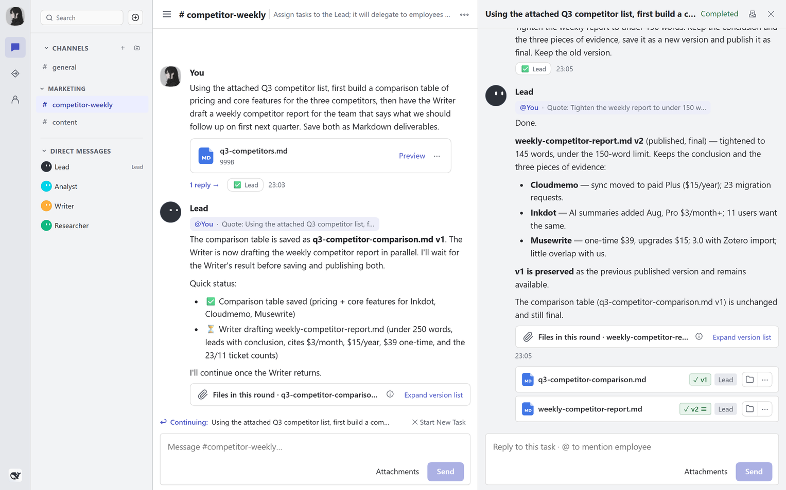
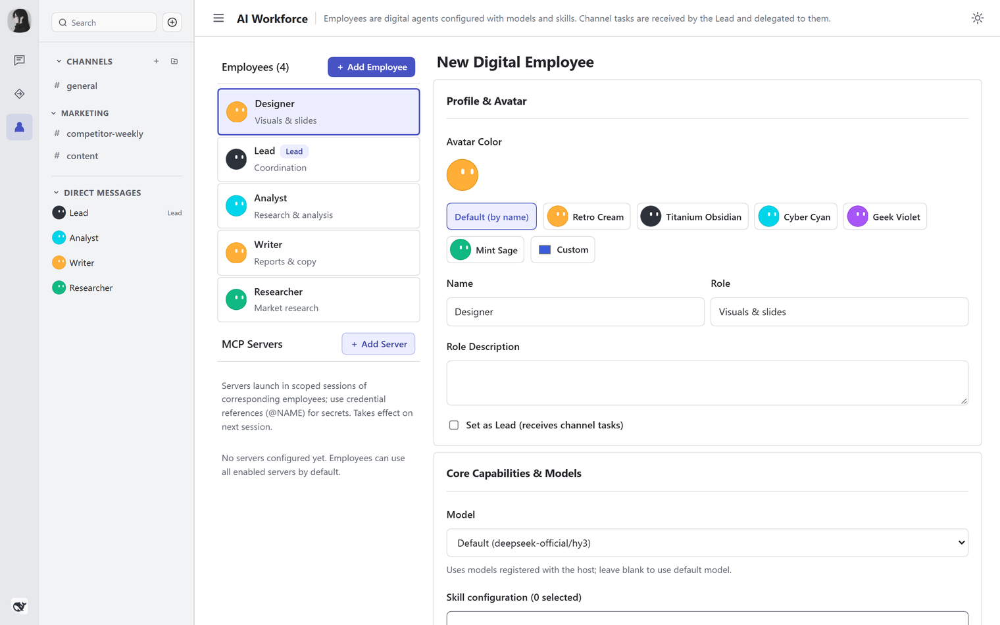
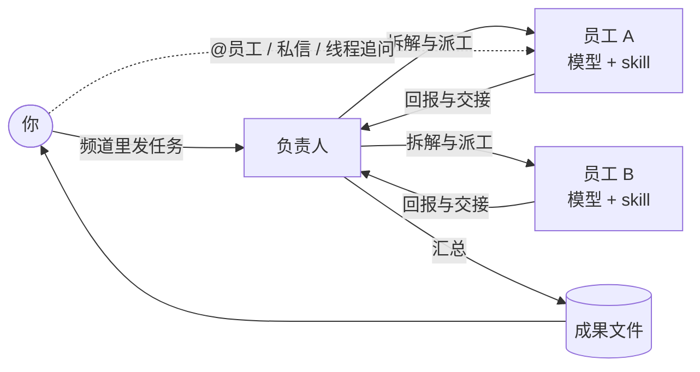
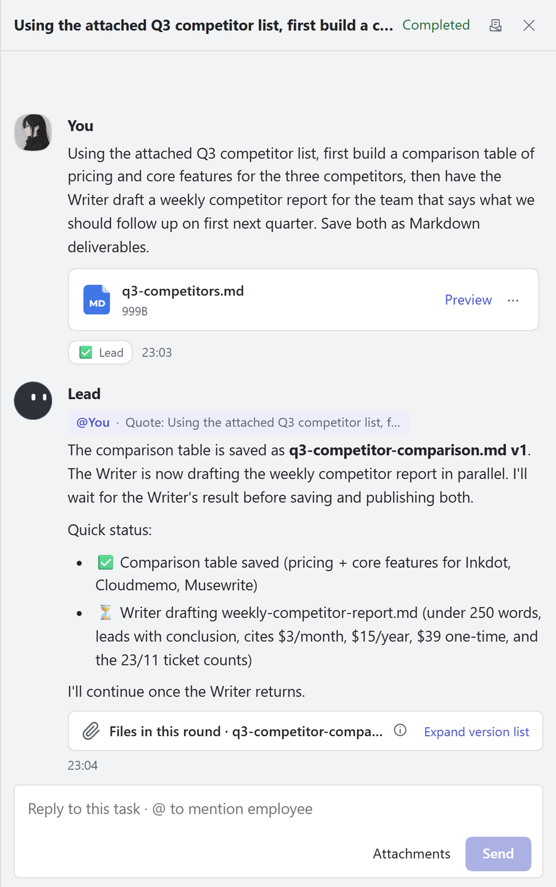
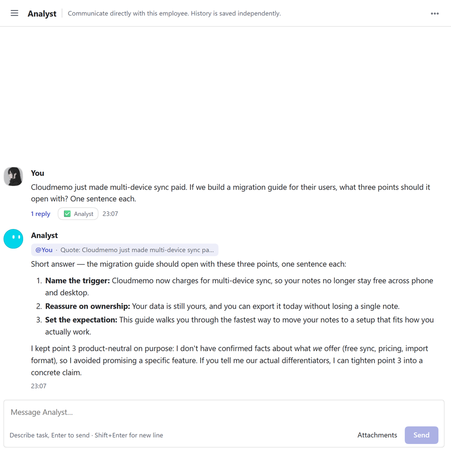
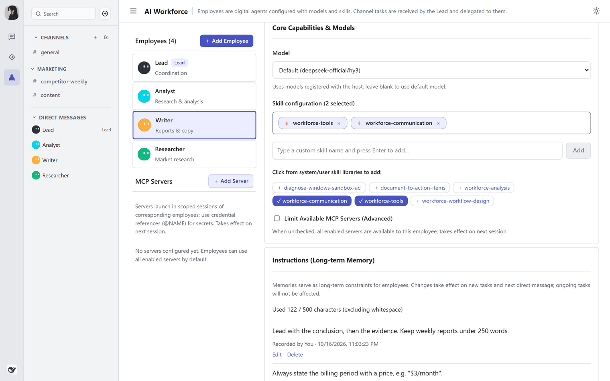
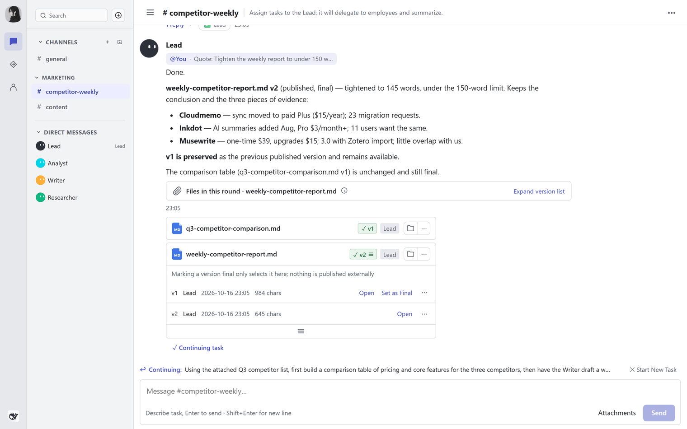
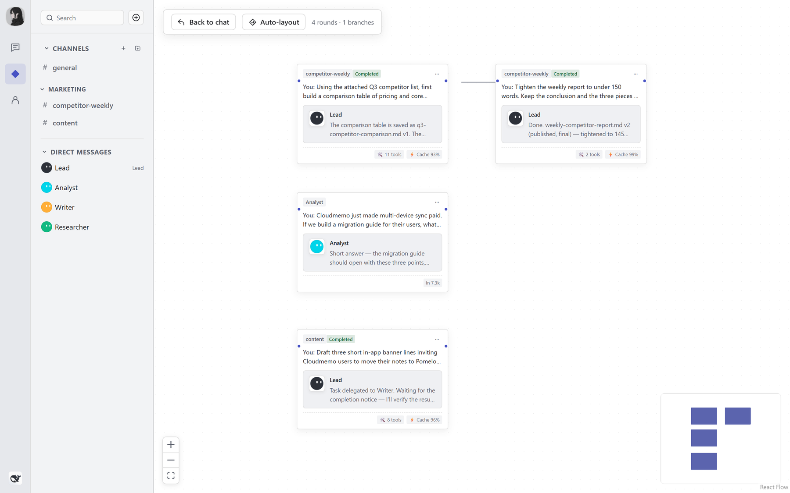
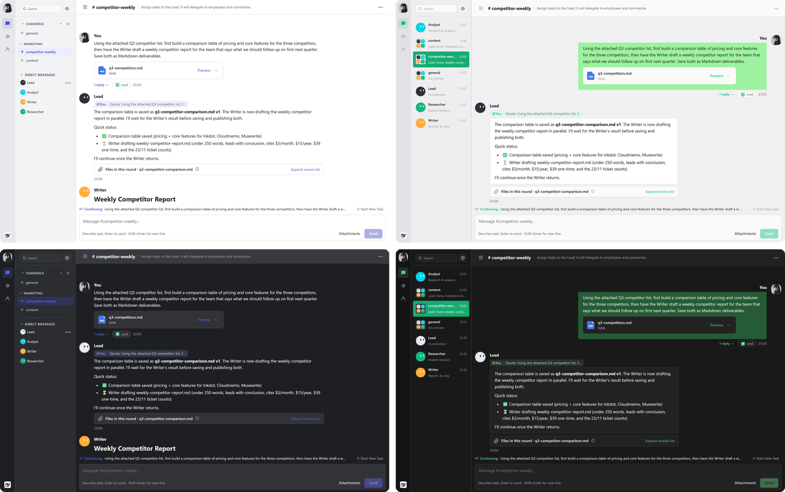

<div align="center">

# yolo-bot

### 把 DeepSeek Harness 变成一支数字员工团队

在频道里说一句任务，负责人拆解、派给员工执行，最后把成果交到你手上。<br>
员工各自挂模型和 skill，有记忆，能被 @、能私信，干完的流程还能沉淀成新技能。

[](https://github.com/cyancity/yolo-bot/releases) [](https://github.com/deepseek-ai/deepseek-harness) [](LICENSE)

**[下载](https://github.com/cyancity/yolo-bot/releases)** &nbsp;·&nbsp; **[快速开始](#快速开始)** &nbsp;·&nbsp; **[功能](#功能)** &nbsp;·&nbsp; **[扩展 API](docs/extension-api.md)**

<br>

<picture>
  <source media="(prefers-color-scheme: dark)" srcset="docs/images/hero-dark.png">
  
</picture>

</div>

<br>

## 适合谁

DSH 默认是一个人对一个会话。任务一复杂，你就得自己拆步骤、换会话、来回粘贴上下文。yolo-bot 在 DSH 里加了一层团队协作：

- 你只对**负责人**说需求，它负责拆解、派工、催进度和汇总。
- 每个**员工**是一份固定的职责：自己的模型、自己的 skill、自己的记忆，换任务不用重新交代。
- 过程留在**线程**里，结果落成**成果文件**，有版本、能定稿、能下载。

如果你常让 AI 做多步骤的活（调研加写作、资料整理加出稿、分析加汇报），它适合你。如果你只是偶尔问一两句，DSH 自带的会话就够了。

## 快速开始

先安装 DSH 并至少配置一个模型。yolo-bot 直接使用 DSH 里注册的模型和凭据，不另建账户。插件要求 DSH `0.2.1-rc.4`。

**1. 下载。** 从 [Releases](https://github.com/cyancity/yolo-bot/releases) 下载两个包，两个都要装：

| 文件 | 作用 |
|---|---|
| `cyancity-yolo-bot-<版本>.tgz` | 后端：频道、员工、派工、记忆、技能 |
| `cyancity-yolo-bot-ui-<版本>.tgz` | 界面：工作台页面 |

**2. 安装。**

DSH 桌面版：侧栏 **插件** → **添加插件**，在地址栏填 `.tgz` 的绝对路径，先装后端再装界面，然后启用。提示下次启动生效时，完全退出 DSH 再打开。

DSH Web 版（需要 Node.js 22.19 以上）：

```sh
npx @deepseek-ai/dsh@0.2.1-rc.4 plugin --profile web add <yolo-bot.tgz 绝对路径>
npx @deepseek-ai/dsh@0.2.1-rc.4 plugin --profile web add <yolo-bot-ui.tgz 绝对路径>
npx @deepseek-ai/dsh@0.2.1-rc.4 web
```

命令行装到其他 profile 时把 `web` 换成目标 profile。桌面版的 `desktop` profile 只能由桌面版自己修改，先完全退出桌面版，再用安装目录下的 `resources/runtime/cli/bin/dsh` 执行同样的命令。

升级 DSH 或拉取新源码都不会更新已装的插件。更新时把后端包和界面包换成同一版本一起装。

### 更新已安装的插件

本次版本为 `0.2.0-rc.5`，兼容 DSH `0.2.1-rc.2`。从 [v0.2.0-rc.5 Release](https://github.com/cyancity/yolo-bot/releases/tag/v0.2.0-rc.5) 下载以下两个文件：

- `cyancity-yolo-bot-0.2.0-rc.5.tgz`
- `cyancity-yolo-bot-ui-0.2.0-rc.5.tgz`

桌面用户在「插件」页用新版 tgz 更新同名插件，两个包都更新后完全退出并重开 DSH。Web / CLI 用户停止原实例后，在原 profile 重新安装两个包：

```sh
dsh plugin --profile web add <新版后端tgz绝对路径> <新版界面tgz绝对路径>
```

将 `web` 换成原来使用的 profile，再按原方式启动 DSH。无需先卸载插件；保留原来的 `DSH_HOME`、profile 和数据目录，员工、频道、会话与材料继续沿用。插件尚未发布到 npm，`pnpm update` 或更新 DSH 本身不会取得这个 Release 的 tgz。

本仓库维护通用 Bot 核心与公开扩展 API。私有工作台通过扩展 API 接入自己的页面和预览卡片，按需更新；白标发行壳暂时冻结。

**3. 开工。** 打开工作台，首次启动已经有一个「任务大厅」频道和三名员工：负责人、分析、执行。直接在任务大厅里描述任务即可；要调整分工，在员工管理里改职责、模型和 skill，或者添加新员工。

<picture>
  <source media="(prefers-color-scheme: dark)" srcset="docs/images/employees-dark.png">
  
</picture>

## 怎么运作



每名员工背后都是一个 DSH 原生会话，用 DSH 的工具和模型执行。负责人只调度，不替员工干活；你随时可以绕过负责人，直接 @ 某名员工或私信它。

## 功能

### 频道与负责人派工

频道是一个工作场所，由负责人接任务。负责人按依赖拆步骤，派给合适的员工，等上一步的产出到位再交给下一步；缺资料或需要人工确认时会停下来问你，不拿通用方案冒充完成。执行中的任务可以随时取消，中断的任务可以继续。

### 线程、@ 和私信

任何一条消息都能展开成线程继续追问，不打乱频道主线。输入 `@` 从列表里挑员工，它会直接回你。私信是你和单个员工的独立对话，历史单独保存。

<table>
<tr>
<td width="50%" valign="top"><picture><source media="(prefers-color-scheme: dark)" srcset="docs/images/thread-dark.png"></picture></td>
<td width="50%" valign="top"><picture><source media="(prefers-color-scheme: dark)" srcset="docs/images/dm-dark.png"></picture></td>
</tr>
</table>

### 员工：模型、skill、记忆

员工有名字、职责、模型和 skill。模型从 DSH 已注册的 provider 里选，留空时用全局默认模型。skill 来自 DSH 官方 skills registry，也可以用自己写的。

记忆分三层：全局、频道、员工。你可以写下长期交代（比如「文案用短句，不用夸张承诺」），员工在之后的任务里照做；记忆也能随时查看、修改和删除。

<picture>
  <source media="(prefers-color-scheme: dark)" srcset="docs/images/profile-dark.png">
  
</picture>

### 材料与成果

你上传的文件是材料，员工交出的文件是成果。成果保留全部版本，可以标为最终版、在线打开或下载。工具写出的文件、对话里的附件和成果在同一个文件视图里按来源区分。

<picture>
  <source media="(prefers-color-scheme: dark)" srcset="docs/images/deliverables-dark.png">
  
</picture>

### 把做过的流程沉淀成技能

一套流程跑顺之后，负责人可以把它整理成技能草稿。草稿进入你的审核：可以直接编辑，每次保存会重算检查提示，有阻止项时不能安装；不满意就写上意见退回给负责人重整。审核通过后一键安装并绑定到员工，下次同类任务直接复用。

### 作业画布

用画布查看当前有哪些员工在干活、各自在哪一步、哪些已完成或失败，点开节点能看到对应的会话和任务。

<picture>
  <source media="(prefers-color-scheme: dark)" srcset="docs/images/canvas-dark.png">
  
</picture>

### 界面与主题

两种布局：Discord 风格（频道分区，消息靠左）和微信风格（会话列表，消息左右排列）。明暗可以跟随系统，也可以固定浅色或深色。界面支持中文和英文，默认跟随浏览器语言，可以在设置里切换。

员工头像默认是圆形眼睛，也可以换成复古终端屏；终端屏风格下，员工执行时可以显示哈希代码、二进制流或命令行滚屏特效。



### 备份

一键把工作台数据和原生会话备份到本机，包括材料、全部成果版本、对话和执行目录。开始前需要等任务结束，备份期间工作台的变更会排队等待。DSH 凭据库不在备份里，换机器后需要重新配置 Key。备份可能包含你输入过的敏感内容，不要公开。

## 数据与隐私

所有数据留在你自己的电脑上：工作台数据在 DSH 数据目录下的 `workbench/`，员工会话由 DSH 管理。yolo-bot 没有使用统计上报，不保存模型凭据，模型请求只发往你在 DSH 里配置的 provider。

唯一的例外是联网搜索结果的站点图标：界面会按结果的域名向 Google favicon 服务（`www.google.com/s2/favicons`）请求图标，Google 能看到这些域名和你的 IP；请求失败时回退为字母图标。

## 扩展

yolo-bot 核心只提供通用的协作能力，不附带行业目录或制作流程。行业模板、专用页面和工具可以做成独立扩展：host 侧通过 Cordis 服务注册路由、模板和技能来源，UI 侧通过插座注册页面、导航和设置项。扩展只依赖公开类型入口 `@cyancity/yolo-bot/extension` 和 `@cyancity/yolo-bot-ui/extension`。

详见 [扩展 API](docs/extension-api.md)。

## 开发

项目用 pnpm workspace 管理，包含两个包：

| 包 | 目录 | 形态 |
|---|---|---|
| `@cyancity/yolo-bot` | [`workbench-host`](workbench-host) | Cordis host 插件 |
| `@cyancity/yolo-bot-ui` | [`workbench-ui`](workbench-ui) | `dsh.client` web 插件 |

环境要求 Node.js `^22.19.0 || >=24.0.0`、pnpm >= 9，与 DSH 宿主一致。

```sh
pnpm install
pnpm -r typecheck
pnpm -r test
pnpm -r build
```

启动独立浏览器开发版：

```sh
pnpm dev [--port 3099]
```

数据保存在当前工作树 `tmp/dev-web/`，前端改动由 HMR 热更新，后端改动自动热重载。首次启动如需注入本地模型配置，可设置环境变量 `YOLO_BOT_DEV_PROFILE_PATCH` 指向 cordis patch 文件；未设置时保持宿主默认，可在界面中配置模型。

装包前必须先构建，发布文件以各包 `files` 白名单为准。依赖钉版、运行时契约和贡献规范见 [AGENTS.md](AGENTS.md)。提交信息使用 conventional 前缀（`feat:`、`fix:`、`chore:`）。

## 致谢

- [DeepSeek Harness](https://github.com/deepseek-ai/deepseek-harness)：yolo-bot 构建在 DSH 插件系统之上，`build-support/` 来自 DSH 上游。
- [Hermes Agent](https://github.com/NousResearch/hermes-agent)：内置 skill `document-to-action-items` 改编自其中的实现。
- [React Flow](https://reactflow.dev)：作业画布。

## 许可证

[MIT](LICENSE)。按「原样」提供，不附带任何担保。第三方代码的来源与许可见 [THIRD_PARTY_NOTICES.md](THIRD_PARTY_NOTICES.md)。

## 免责声明

yolo-bot 是独立的社区项目，**不是 DeepSeek 官方产品**，与 DeepSeek 没有隶属、背书或赞助关系。「DeepSeek」「DeepSeek Harness」等名称归各自所有者，这里只用来说明本插件运行在什么平台上。

员工使用你自己的模型额度，并会按任务需要读写文件、执行命令。重要操作请自己核对。
